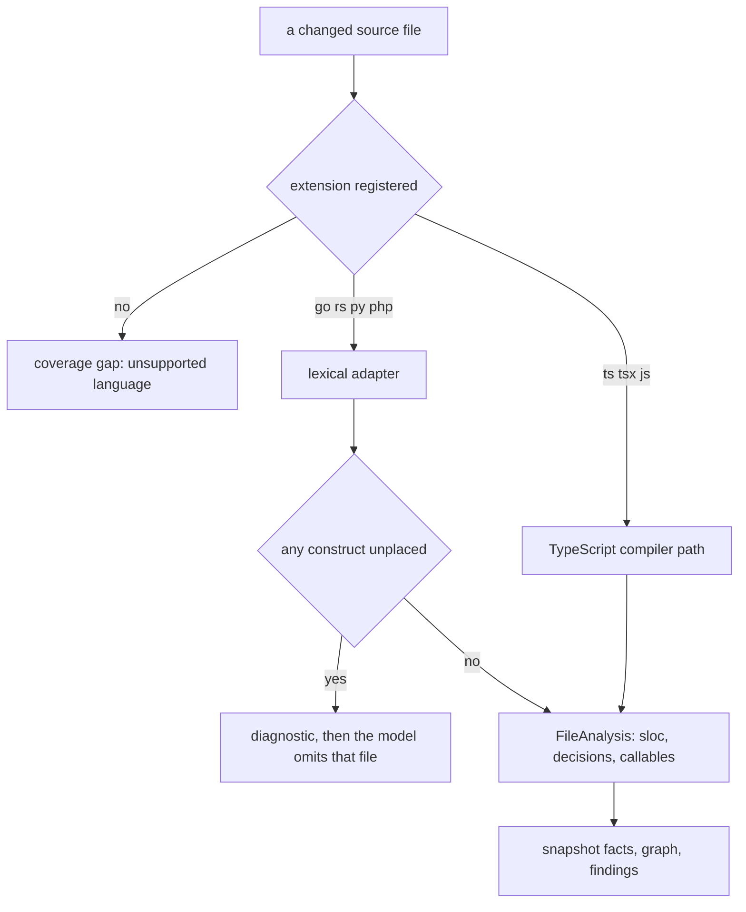

# Measured languages

Contour measures five languages. TypeScript and JavaScript go through the TypeScript compiler.
Go, Rust, Python and PHP go through a lexical adapter that reads tokens, not a grammar (iniznet/pi-trackers#99).

| Language | Extensions | Adapter |
|---|---|---|
| TypeScript / JavaScript | ts tsx mts cts js jsx mjs cjs | TypeScript compiler, `src/core/metrics.ts` |
| Go | go | `src/core/languages/go.ts` |
| PHP | php | `src/core/languages/php.ts` |
| Python | py | `src/core/languages/python.ts` |
| Rust | rs | `src/core/languages/rust.ts` |

## What an adapter measures

- **SLOC**: lines holding at least one token, so blank lines and comments never count.
- **Decisions**: the tokens named below, counted once per file and again per callable.
- **CC**: own decisions + 1. A nested callable owns its own decisions.
- **Mass**: CC x sqrt(SLOC).
- **Clones**: a digest of the callable body tokens, so identical bodies group.
- **Imports**: literal module specs only, handed to the Fovea substrate for resolution.

## Decisions per language

| Language | Counted as a decision |
|---|---|
| Go | `if`, `for`, a non-default `case`, `&&`, `||` |
| Rust | `if`, `while`, `for`, `loop`, a non-wildcard `match` arm, `&&`, `||` |
| Python | `if`, `elif`, `for`, `while`, `except`, `and`, `or`, and a mid-line `if` (ternary or comprehension filter) |
| PHP | `if`, `elseif`, `for`, `foreach`, `while`, `do`, `catch`, a non-default `case`, a ternary `?`, `??`, `&&`, `||`, `and`, `or` |

Two constructs stay out on purpose. Python `with` and Go `select` do not open a branch in the
JavaScript sense, so counting them would make cross-language deltas incomparable.

## Callables

- Go: `func` declarations, methods with a receiver, function literals.
- Rust: `fn` items, `fn` inside an `impl` or `trait` block (kind `method`), block-bodied closures.
- Python: `def` and `async def`; a `def` indented inside a class is a method.
- PHP: `function`, methods, closures, and `fn ($x) => ...` arrow functions.

An expression-bodied closure is not a callable: Rust `|x| x + 1`, Python `lambda`, and a
one-line Python `def` still belong to their enclosing callable.

## Honest degradation

An adapter reports a diagnostic for anything it cannot place. The model then drops that file's
metrics and lists the diagnostic as a coverage gap. A gap is always visible; a guess is never
silent. Current triggers:

- inline markup after a PHP `?>`
- an unterminated string, comment, or heredoc opener
- a computed import target

## Known limits

- Rust `use` and PHP `use` specs may stay unresolved. The Fovea substrate resolves import families
  for TypeScript, Python, Rust and Go, and has none for PHP (iniznet/pi-trackers#100).
- Identifier normalization is exact, as on the compiler path: a clone needs identical tokens.
- A PHP file that leaves and re-enters source mode reports a gap instead of partial numbers.
